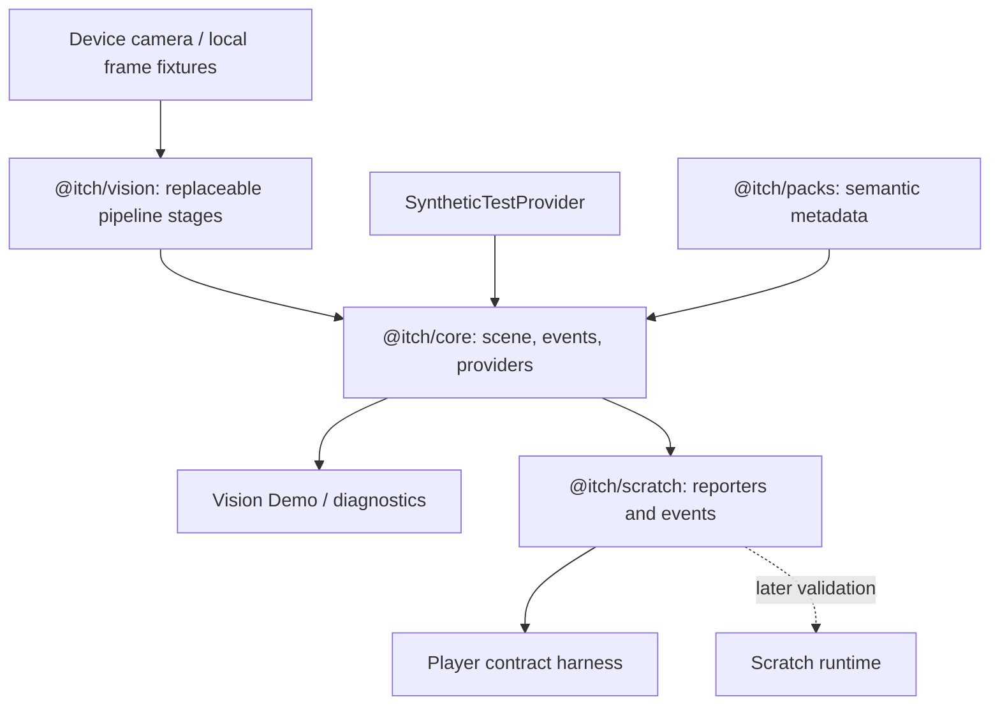

# ITCH

ITCH (Interactive Tangibles for Creative Hands) is an open, local toolkit for turning physical pieces into meaningful inputs for Scratch projects. The reference design processes the same tablet or phone's camera locally and publishes a versioned scene through a provider interface.

This repository implements a **Phase 0 development baseline** from [ITCH Product & Technical Roadmap v0.1](<ITCH_Product_Technical_Roadmap_v0.1 (1).docx>) (ITCH-ROADMAP-001). The [text reference](docs/reference/roadmap-v0.1.txt) and [scope reconciliation](docs/architecture/scope.md) explain the implementation boundary.



Implemented: strict TypeScript packages, validated scene/pack contracts, synthetic scenes and subscriptions, scene differences and duplicate suppression, deterministic spatial interpretation, a camera/frame-source abstraction, a pipeline with explicit placeholder stages, a Vision Demo with local diagnostics, scene timeline recording/replay and representative still PNG/metadata export, and Scratch adapter tests including real Node VM reporter registration and event-stack execution. The starter pack defines **C A T D O G**, with draft printable assets.

Pending: automatic workspace calibration, real letter recognition, tracking/debounce of raw detections, camera sequence recording, browser Scratch integration/.sb3 playback, and mobile-device acceptance evidence. Core scene inputs must already be stabilized; duplicate suppression alone does not remove camera noise. The player is a mock runtime harness and cannot load `.sb3` files. The Phase 0 exit gate is still open until actual iPad/iPhone-class and Android devices are probed. Accuracy, latency, optics, and mobile compatibility targets are requirements to measure, not achieved claims.

The significant directories are:

| Path                     | Responsibility                                                           |
| ------------------------ | ------------------------------------------------------------------------ |
| `packages/protocol`      | Versioned scene and pack contracts, validation and serialization         |
| `packages/core`          | Provider interfaces, subscriptions, scene differences and interpretation |
| `packages/vision`        | Local frame sources, camera lifecycle and injected vision stages         |
| `packages/scratch`       | Scratch-facing reporters, event dispatch and registration spike          |
| `packages/packs`         | Validated reference metadata                                             |
| `packages/devtools`      | Diagnostics, capability reports and fixture recording/replay             |
| `apps/vision-demo`       | Camera and synthetic-scene development app                               |
| `apps/player`            | Scratch adapter contract harness                                         |
| `fixtures`               | Deterministic scenes, frame metadata and expected timelines              |
| `tangible-packs/starter` | Physical pack manifest and draft printable letters                       |
| `hardware`               | Draft A5 workspace and adjustable mirror-jig dimensions                  |
| `docs`                   | Architecture, ADRs, development and test guidance                        |
| `scripts`                | Toolchain bootstrap, architecture checks and benchmarks                  |

Install Node **24.21.0** (pinned in `.node-version`) and pnpm **10.20.0**. On Windows, the optional portable Node setup downloads the official distribution into this workspace and verifies its checksum:

```powershell
. ./scripts/setup-node.ps1
npm install --global pnpm@10.20.0
pnpm install
pnpm dev
```

Otherwise use your existing Node version manager, then run `pnpm install` and `pnpm dev`. The Vision Demo opens at `http://localhost:5173`. Use its synthetic controls without a camera; explicitly start the camera for a raw preview. Camera imagery and synthetic objects are separate sources: a synthetic word on the screen does not demonstrate recognition of a camera image.

```sh
pnpm dev:player   # Scratch contract harness, localhost:5174
pnpm lint
pnpm typecheck
pnpm test
pnpm build
pnpm format:check
pnpm benchmark
pnpm exec playwright install chromium
pnpm test:e2e
```

The browser apps support a LAN development server. Camera access on another phone/tablet requires **HTTPS trusted by that device**; plain HTTP on a LAN IP is insufficient. Configure `ITCH_HTTPS_CERT` and `ITCH_HTTPS_KEY` as certificate file paths before `pnpm dev`. See [development setup](docs/development.md) for the complete procedure and the test-device report workflow.

Local processing is the default. The apps do not upload camera frames, invoke cloud inference, analyze faces or track identities. Preview is explicitly requested in the development app; recording exports local files only. Dependencies need network access during installation. Offline deployment of preloaded production assets remains an acceptance task.

Read [CONTRIBUTING.md](CONTRIBUTING.md), the [architecture overview](docs/architecture/README.md), [testing guide](docs/testing.md), and [hardware assumptions](hardware/README.md) before adding a stage or pack. Use the roadmap's requirement/test IDs in relevant issues and test reports. Hardware assets are dimensional drafts; do not treat the placeholder corner marks or reserved piece marker IDs as a proven recognition format.

The roadmap progresses from Phase 0 spikes to Phase 1 optics/calibration, Phase 2 piece identity/tracking, Phase 3 Scratch play, Phase 4 open hardware, Phase 5 remote providers, Phases 6–7 drawings, and Phases 8–9 physical code/community formats. Next, capture the missing mobile capability/camera evidence and run the hello extension with a real browser Scratch runtime before implementing four-anchor detection and homography in Phase 1.
